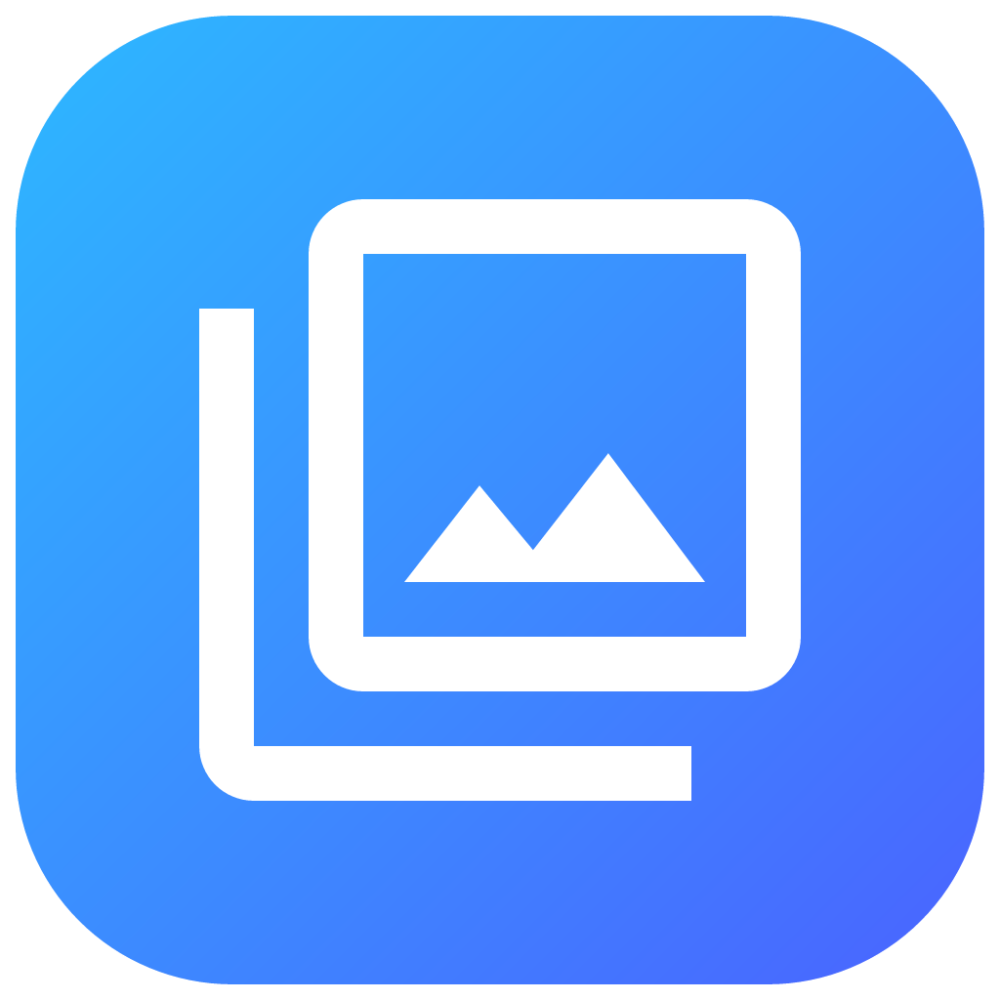

<p align="center">
  
</p>

<h1 align="center">看图 KanTuNext</h1>

<p align="center">
  <strong>一款轻快、私密、跨平台的离线看图与照片整理工具。</strong><br>
  打开一个文件夹，照片会按拍摄月份自动排好。快速浏览大图、筛选和标记照片、清理重复项，也可以直接选中并复制图片里的文字。
</p>

<p align="center">
  <a href="https://github.com/pengpercy/KanTuNext"></a>
  <a href="https://dotnet.microsoft.com/download/dotnet/10.0"></a>
  <a href="LICENSE"></a>
  <a href="https://github.com/pengpercy/KanTuNext/releases/latest"></a>
  <a href="https://github.com/pengpercy/KanTuNext/actions/workflows/ci.yml"></a>
  <a href="https://github.com/pengpercy/KanTuNext/releases"></a>
  <br>
  
</p>

<p align="center">
  <a href="https://github.com/pengpercy/KanTuNext/releases/latest"></a>
  <a href="CHANGELOG.md"></a>
  <a href="#从源码运行"></a>
</p>

照片的扫描、解码、信息读取与文字识别都在本机完成，不会被上传。应用仅在检查更新时访问 GitHub；这项功能可以在设置中关闭。

## 为什么选择「看图」

- **打开就是时间线。** 不用导入图库，也不用等待云端同步；选择文件夹后即可按拍摄月份浏览。
- **为挑片与整理而生。** 用「好 / 中 / 差」快速标记，按类型筛选，一键找出重复照片，还能从「最近删除」恢复误删内容。
- **图片里的文字可以直接复制。** 中英文 OCR 完全离线，像复制网页文字一样框选照片或截图里的内容。
- **看图体验完整。** 平滑翻页、缩放与平移、实拍参数、拍摄位置、动图，以及常用文件操作都集中在一个窗口里。
- **原生、轻量、跨平台。** 发布版本使用 NativeAOT，无需另外安装 .NET 运行时；同一套界面运行在 Windows、macOS 和 Linux 上。

## 功能一览

| 领域 | 能力 |
| --- | --- |
| 浏览 | 按拍摄月份分组的照片时间线；小、中、大、最大四档缩略图；键盘选图与翻页 |
| 查找与分类 | 按文件名或日期搜索，支持 `2016`、`2016年6月`、`6月` 等输入；自动归类大图片、屏幕快照和视频 |
| 文件夹 | 添加常用文件夹，在侧边栏展开子文件夹；目录内容变化后自动刷新 |
| 整理 | 标记「好 / 中 / 差」；扫描内容完全相同的重复照片；将照片移到系统废纸篓并从「最近删除」恢复 |
| 看大图 | 滚轮与触控板缩放、拖动平移、1:1 实际大小、适应窗口、旋转和平滑切换；支持 GIF / WebP 动图 |
| 图片信息 | 相机与镜头、光圈、快门、ISO、焦距、曝光补偿、白平衡、尺寸、文件大小、颜色配置、拍摄时间、经纬度、海拔与朝向 |
| 文字识别 | 自动识别照片和截图里的中英文；直接框选并复制局部文字，或打开识别面板查看和复制全文 |
| 系统集成 | 复制图片或文件路径、在文件管理器中显示、用其他应用打开；跟随系统浅色 / 深色外观 |
| 更新 | 可选的启动检查、后台下载与重启更新；也可以完全关闭更新检查 |

## 快速上手

1. 点击「添加常用文件夹」，选择照片所在的目录。
2. 在左侧选择文件夹或分类，在右侧时间线中浏览照片。
3. 双击缩略图打开看图窗口，使用方向键或空格切换照片。
4. 按 `I` 查看完整图片信息，按 `T` 显示文字识别结果，按 `H` 开关抓手工具。

看图窗口还支持以下常用操作：

| 操作 | 快捷键 |
| --- | --- |
| 上一张 / 下一张 | `←` / `→`，也支持 `↑` / `↓`、`Page Up` / `Page Down` |
| 下一张 | `Space` |
| 放大 / 缩小 | `+` / `-` |
| 适应窗口 / 实际大小 | `0` / `1` |
| 向左 / 向右旋转 | `R` / `Shift+R` |
| 图片信息 | `I` |
| 识别文字 | `T` |
| 抓手工具 | `H` |
| 播放实况照片（macOS） | `L` |

## 格式支持

所有平台均可打开 JPEG、PNG、GIF、WebP、BMP、ICO、TIFF、HEIC / HEIF 和 AVIF。Windows 与 Linux 安装包已经包含 HEIC / AVIF 解码库，无需另外安装系统扩展或解码插件。

此外：

- macOS 还可借助系统 ImageIO 打开 JPEG XL、PSD 和常见相机 RAW 格式。
- macOS 与 Windows 支持生成视频缩略图。
- 实况照片可被识别与归组；macOS 支持在看图窗口内播放动态部分。
- 多页 TIFF 当前显示第一页。

## 下载

前往 [Releases](https://github.com/pengpercy/KanTuNext/releases) 下载与你的系统和处理器匹配的安装包。

| 系统 | 支持版本 | 安装包 |
| --- | --- | --- |
| Windows | Windows 10 / 11，x64 与 arm64；另提供 Windows 7 x64 兼容版 | `.zip`，解压即用 |
| macOS | macOS 12 及以上，Intel 与 Apple Silicon | `.dmg` / `.zip` |
| Linux | x64 与 arm64，glibc 2.31 及以上 | AppImage / `.deb` / `.rpm` |

> [!NOTE]
> macOS 安装包目前未经过 Apple 公证。首次启动时，请在 Finder 中右键点击 `KanTuNext.app`，选择「打开」；也可以执行 `xattr -dr com.apple.quarantine /Applications/KanTuNext.app`。

## 从源码运行

需要 [.NET 10 SDK](https://dotnet.microsoft.com/download/dotnet/10.0)；仓库中的 `global.json` 定义了具体版本。

```bash
git clone https://github.com/pengpercy/KanTuNext.git
cd KanTuNext
dotnet run --project src/KanTuNext.Desktop
```

运行测试：

```bash
dotnet test
```

## 项目结构

| 项目 | 职责 |
| --- | --- |
| `KanTuNext.Core` | 文件夹扫描、时间线、搜索、标签、最近删除、EXIF 与 OCR 数据模型 |
| `KanTuNext.Desktop` | Avalonia 桌面界面、图片解码、平台 OCR、实况照片、系统集成与自动更新 |
| `KanTuNext.Tests` | 搜索、时间线、媒体库筛选、EXIF、OCR 布局等单元测试 |

发布版本基于 .NET 10 与 Avalonia，并使用 NativeAOT 构建。OCR 在 macOS 上使用 Vision，在 Windows 上使用系统 OCR，在 Linux 安装包中使用随应用提供的 Tesseract（简体中文与英文）。

## 许可

本项目采用 [MIT License](LICENSE)。安装包内附第三方解码库及其许可，详见安装目录中的 `licenses/`。
